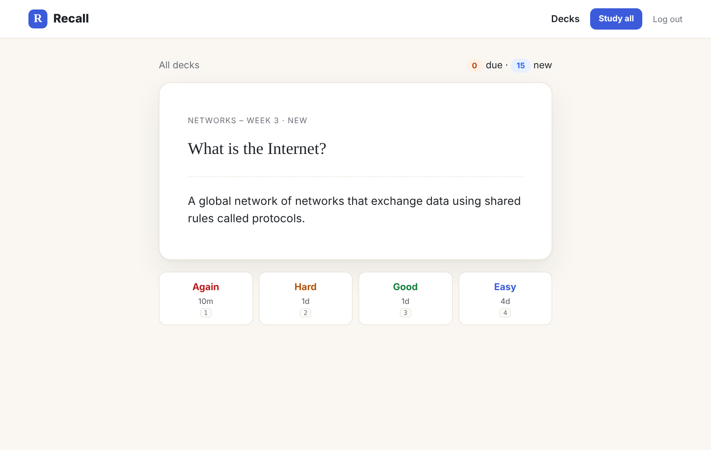
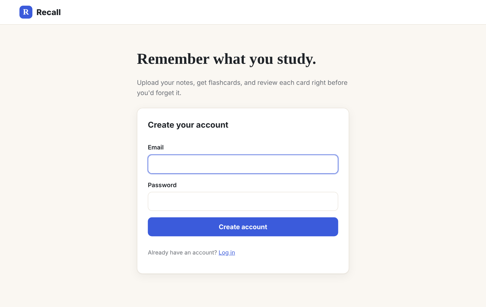
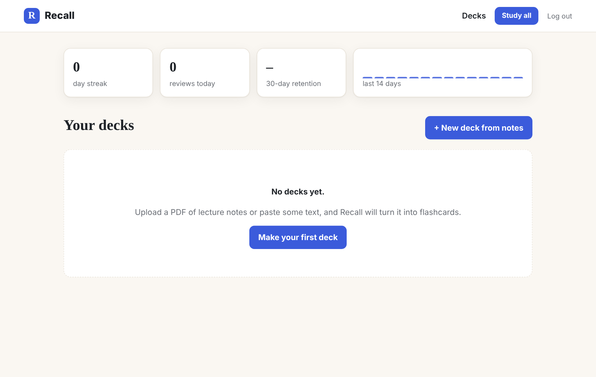
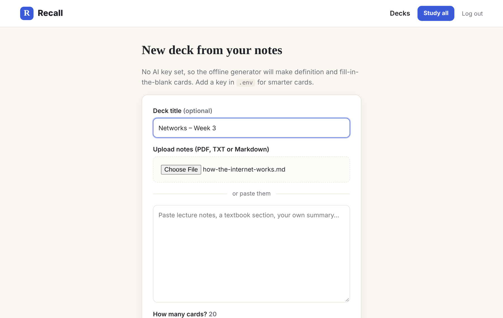
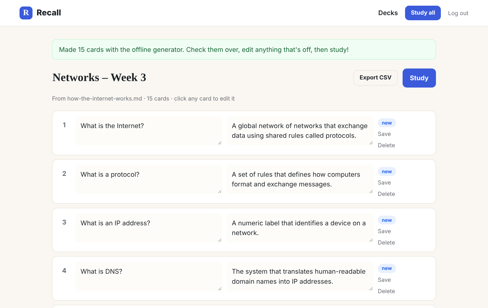
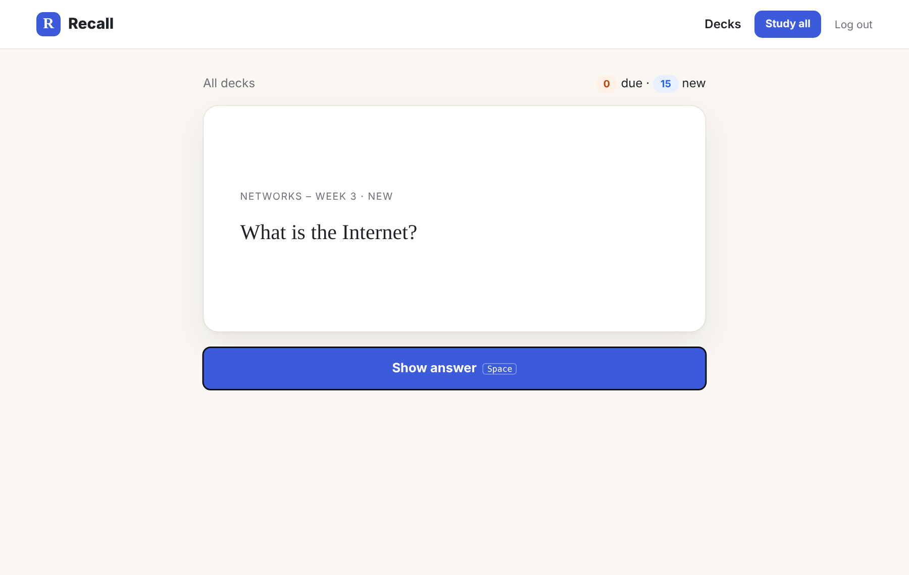
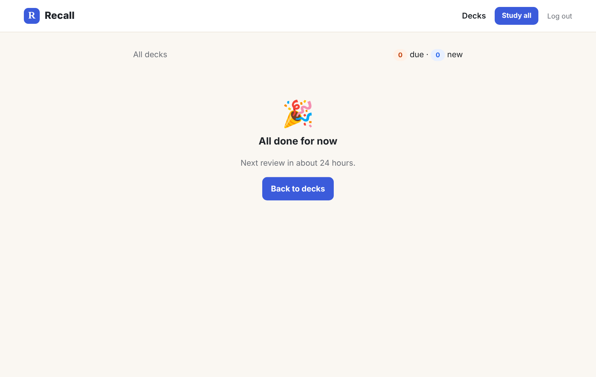
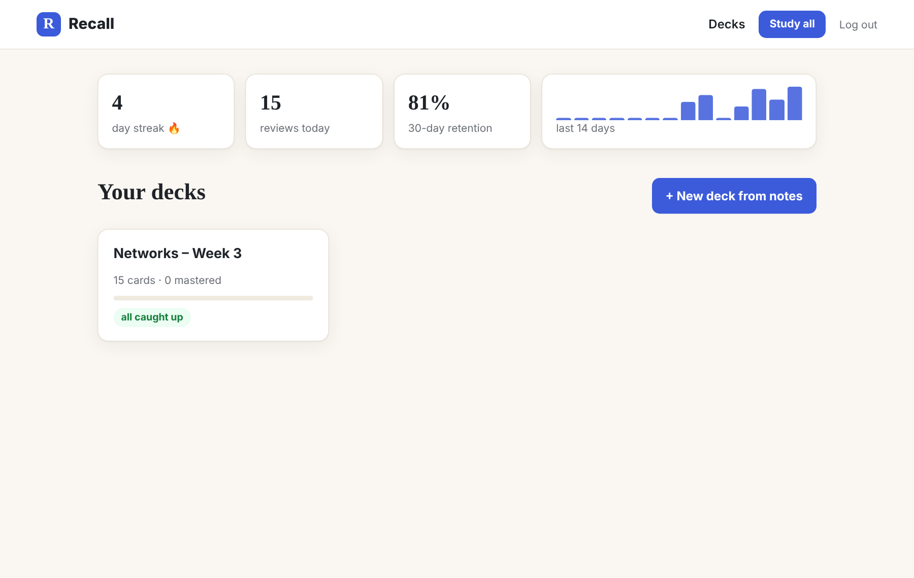
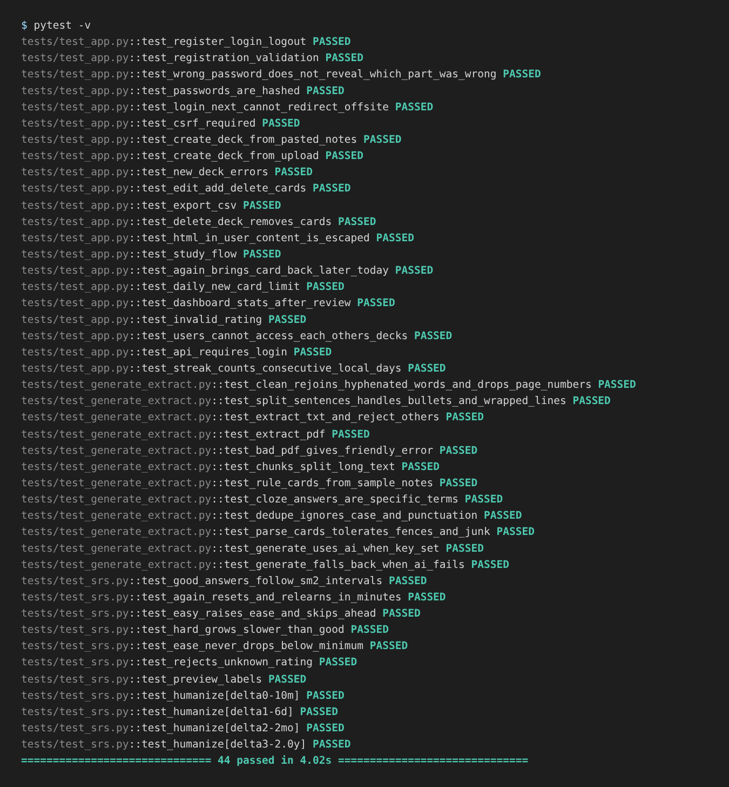

# Recall 🧠

[](https://github.com/Juhitha-D/recall/actions/workflows/ci.yml)


**Turn your study notes into flashcards, then actually remember them.**

Upload your lecture notes (PDF, text or Markdown) and Recall writes flashcards from them. Then it quizzes you using **spaced repetition**: cards you know well come back after days or weeks, and cards you struggle with come back sooner. You spend your study time where it matters.



---

## Contents

- [What it does](#what-it-does)
- [See it in action](#see-it-in-action)
- [Example: notes in, flashcards out](#example-notes-in-flashcards-out)
- [Getting started](#getting-started) (step by step, no experience needed)
- [Using AI for better cards (optional)](#using-ai-for-better-cards-optional)
- [Troubleshooting](#troubleshooting)
- [How spaced repetition works](#how-spaced-repetition-works)
- [How it's built](#how-its-built)
- [Tests](#tests)
- [Roadmap](#roadmap)

---

## What it does

| | |
|---|---|
| 📄 **Notes → flashcards** | Upload a PDF, TXT or Markdown file, or paste text. Recall finds definitions and key terms and turns them into question-and-answer and fill-in-the-blank cards. |
| 🤖 **AI or offline** | With an AI key (Claude, OpenAI, Groq or a free local Ollama model), an AI writes the cards. Without one, a built-in generator still makes them, with no internet needed. |
| 🔁 **Spaced repetition** | After each card, rate how well you knew it. Recall uses the **SM-2** algorithm (the idea behind Anki and SuperMemo) to decide when you see it next. |
| ⌨️ **Fast studying** | `Space` flips the card, `1`–`4` rates it. No mouse needed. |
| 📈 **Progress tracking** | Day streak, reviews per day, how much you're remembering, and how many cards you've mastered. |
| ✏️ **Full control** | Edit, add or delete any card. Export a deck as CSV (works with Anki). |
| 🔒 **Private and secure** | Runs on your own computer. Passwords are hashed, forms are protected against CSRF attacks, and users can never see each other's cards. |

---

## See it in action

The screenshots below were taken of the real app, using the sample notes in [`samples/how-the-internet-works.md`](samples/how-the-internet-works.md).

### 1. Create an account
Your account lives only on your own computer.



### 2. Start with an empty dashboard



### 3. Upload your notes
Pick a file (or paste text), give the deck a name, and choose how many cards you want.



### 4. Review the generated cards
Recall made **15 cards** from the sample notes. Click any card to fix its wording before you study.



### 5. Study: see the question…



### 6. …then reveal the answer and rate yourself
Each button shows when you'll see the card again: **Again** = 10 minutes, **Good** = tomorrow, **Easy** = in 4 days.


### 7. Finish the session
When nothing is due, Recall tells you when to come back.



### 8. Track your progress
Streak, today's reviews, how much you're remembering, and a 14-day chart.
*(This screenshot uses a few days of demo study history so the chart has something to show.)*



---

## Example: notes in, flashcards out

These are the actual cards Recall's **offline generator** (no AI) made from the [sample notes](samples/how-the-internet-works.md):

**Definition cards** (found from sentences like *"TCP is a … protocol that …"*):

| Question | Answer |
|---|---|
| What is TCP? | A connection-oriented protocol that guarantees packets arrive in order and without errors. |
| What is DNS? | The system that translates human-readable domain names into IP addresses. |
| What is an IP address? | A numeric label that identifies a device on a network. |
| What does a status code of 404 mean? | The server could not find the requested resource, while 500 signals an error inside the server. |
| What is latency? | The time it takes for a packet to travel from source to destination. |

**Fill-in-the-blank cards** (important terms picked automatically with TF-IDF):

| Question | Answer |
|---|---|
| Before sending data, _____ performs a three-way handshake using SYN, SYN-ACK and ACK messages. | TCP |
| Video calls and online games often use _____ because low latency matters more than perfect delivery. | UDP |
| IPv6 uses 128-bit addresses to solve the shortage of _____. | IPv4 addresses |

With an AI key, the cards go further: "why" and "how" questions, and answers rephrased in plain language.

---

## Getting started

### What you need
- **Python 3.10 or newer.** To check, open a terminal and run `python --version`.
  Don't have it? Download it from [python.org/downloads](https://www.python.org/downloads/). On Windows, **tick "Add python.exe to PATH"** on the first screen of the installer.
- **Git** (to download the code): [git-scm.com/downloads](https://git-scm.com/downloads). Or click the green **Code** button above and choose **Download ZIP**.

### Step 1: Download the code
```bash
git clone https://github.com/Juhitha-D/recall.git
cd recall
```

### Step 2: Create a virtual environment
A virtual environment keeps this project's packages separate from everything else on your computer.
```bash
python -m venv .venv
```

### Step 3: Turn it on

| Windows (PowerShell / VS Code) | macOS / Linux |
|---|---|
| `.venv\Scripts\activate` | `source .venv/bin/activate` |

Your terminal line should now start with **`(.venv)`**.

> **Windows: "running scripts is disabled on this system"?**
> Run this once, type `Y` if asked, then try activating again:
> ```powershell
> Set-ExecutionPolicy -Scope CurrentUser RemoteSigned
> ```

### Step 4: Install Recall
```bash
pip install -e ".[dev]"
```
This takes a minute or two.

### Step 5: Start the app
```bash
recall
```
Your browser opens **http://127.0.0.1:5000** automatically. Keep the terminal open while you use the app, and press **Ctrl + C** in it to stop.

### Step 6: Make your first deck
1. Click **Create an account** (any email, and a password of 8+ characters).
2. Click **+ New deck from notes**.
3. Upload `samples/how-the-internet-works.md`, or your own notes.
4. Check the cards, then click **Study**.

### Every time after that
```bash
cd recall
.venv\Scripts\activate        # macOS/Linux: source .venv/bin/activate
recall
```

> 💾 **Where is my data?** In `instance/recall.sqlite` inside the project folder. It never leaves your computer, and it's excluded from git.

---

## Using AI for better cards (optional)

1. Copy `.env.example` and rename the copy to `.env`.
2. Open `.env` and add **one** key:
   ```
   ANTHROPIC_API_KEY=your-key-here
   ```
   or `OPENAI_API_KEY=…`. For a free local model with [Ollama](https://ollama.com), set `OPENAI_API_KEY=ollama` and `OPENAI_BASE_URL=http://localhost:11434/v1`.
3. Restart the app. The "New deck" page will say which AI it's using.

If the AI is unreachable, Recall automatically falls back to the offline generator, so you always get cards. `.env` is git-ignored, so your key is never uploaded.

---

## Troubleshooting

| Problem | Fix |
|---|---|
| `'python' is not recognized` | Reinstall Python and tick **"Add python.exe to PATH"**, then open a new terminal |
| `running scripts is disabled` (Windows) | `Set-ExecutionPolicy -Scope CurrentUser RemoteSigned`, then activate again |
| `'recall' is not recognized` | Activate the virtual environment first (Step 3), so `(.venv)` shows |
| `Address already in use` | Recall is already running somewhere. Close it, or run `recall --port 5001` |
| Browser doesn't open | Go to **http://127.0.0.1:5000** yourself |
| "This PDF has no selectable text" | The PDF is a scanned image. Use a different PDF, or paste the text in |
| Few or no cards generated | Use longer notes with full sentences, or add an AI key |

---

## How spaced repetition works

Every card remembers three things: how **easy** it is for you (starts at 2.5), the **interval** until its next review, and how many times **in a row** you've got it right. After each review:

| You press | Meaning | What happens |
|---|---|---|
| **Again** (1) | I forgot | Card comes back in **10 minutes**; streak resets; card gets marked harder |
| **Hard** (2) | Got it, barely | Interval grows slowly (×1.2) |
| **Good** (3) | Got it | **1 day → 6 days → interval × ease** (e.g. 15 days, then ~38 days…) |
| **Easy** (4) | Too easy | Like Good, but the card is marked easier (first time: straight to 4 days) |

So cards you know spread out to weeks and months, while tricky ones keep coming back until they stick. A daily limit on **new** cards (20 by default) keeps your future reviews manageable.

The whole algorithm is in [`recall/srs.py`](recall/srs.py): about 60 lines, with comments.

---

## How it's built

**Tech:** Python · Flask · SQLite · Jinja templates · plain JavaScript · scikit-learn (TF-IDF) · pypdf · pytest

```
recall/
├── recall/
│   ├── __init__.py    app setup, configuration, CSRF protection
│   ├── auth.py        sign up / log in / log out, password hashing
│   ├── db.py          database tables (users, decks, cards, reviews)
│   ├── srs.py         SM-2 spaced repetition algorithm
│   ├── extract.py     reads PDF / TXT / Markdown and cleans the text
│   ├── generate.py    makes flashcards (AI, or the offline generator)
│   ├── views.py       pages, study API, statistics
│   ├── cli.py         the `recall` command
│   ├── templates/     HTML pages
│   └── static/        CSS + the study-screen JavaScript
├── tests/             44 automated tests
├── samples/           example notes to try
└── docs/              screenshots used in this README
```

**How a flashcard is made:**
```
your notes ──► extract.py ──► generate.py ──► database ──► study screen
 (PDF/text)    clean text      AI or rules      cards        SM-2 schedules
                                                             the next review
```

**Design decisions:**
- **The algorithm is a pure function.** `review(card, rating, time)` touches no database or clock, so tests can check exact dates.
- **Simple frontend.** Pages are rendered by the server; only the study screen uses JavaScript, talking to a small JSON API. No build tools.
- **Privacy checks in one place.** Every deck and card lookup goes through `owned_deck()` / `owned_card()`, which only return the logged-in user's data. A test logs in as a second user and confirms every page returns "not found".
- **Times stored in UTC, "today" in local time**, so streaks and daily limits follow your clock. The tests pass in multiple timezones.

**Security:**
- Passwords hashed with scrypt; never stored in plain text
- CSRF tokens on every form and API call
- User content escaped everywhere, so no script injection (XSS)
- Login doesn't reveal which emails have accounts
- Runs on `127.0.0.1`, so only your own computer can reach it

---

## Tests

```bash
pytest -v
```

All 44 tests pass, covering the scheduling math, card generation, PDF reading, accounts, security and privacy:



GitHub Actions runs the tests automatically on **Windows and Linux** with Python 3.10 and 3.12 on every push (the badge at the top).

---

## Roadmap

- [ ] Show the sentence each card came from while studying
- [ ] Dark mode
- [ ] Import decks from Anki CSV files
- [ ] Image cards from diagrams in PDFs
- [ ] FSRS, a newer scheduling algorithm, as an option next to SM-2

---

## Author

Built by **Juhitha** · [github.com/Juhitha-D](https://github.com/Juhitha-D)

## License

MIT: free to use, change and share. See [LICENSE](LICENSE).
